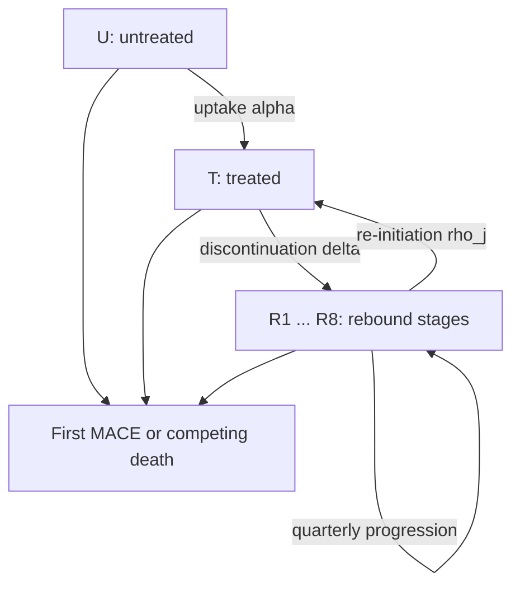

# Model specification

## 1. Target population and estimands

The target population is adults aged at least 45 years with BMI at least 27
kg/m2 and established cardiovascular disease, but without diagnosed diabetes
or HbA1c >=6.5%. This follows the core SELECT criteria. Public NHANES data can
identify prior myocardial infarction and stroke, but not the complete
symptomatic peripheral arterial disease definition.

Four estimands/comparators are separated:

1. **Initiator-cohort estimand (primary):** among 100,000 people initiating
   treatment at time zero, compare real-world discontinuation/re-initiation
   with a SELECT-like implementation, full persistence, and no treatment.
2. **EJPC retained-benefit estimand:** real-world benefit divided by benefit
   under trial-like discontinuation.
3. **DOM retained-benefit estimand:** real-world benefit divided by benefit
   under full treatment persistence.
4. **Population-uptake estimand (secondary):** among an initially untreated
   eligible population, examine policy scenarios for annual initiation.

The primary comparison is intentionally not age-stratified. SELECT placebo
person-time directly anchors the event hazard for the relevant secondary-
prevention population. Age-stratification should be added only when defensible
age-specific MACE hazards are supplied; general-population cardiovascular
mortality is not an adequate substitute.

## 2. State architecture

The rebound chain is a phase-type/semi-Markov approximation. It preserves time
since treatment cessation while remaining solvable as an ordinary differential
equation system. With eight stages and mean stage duration 0.25 years, the final
stage represents approximately 1.875 years or more since cessation.

For each live, first-MACE-free treatment state

\[
x \in \{U,T,R_1,\ldots,R_m\},
\]

three competing exits are possible: nonfatal first MACE, fatal/undetermined
first MACE, and non-cardiovascular death before first MACE.

## 3. Treatment-state equations

Let \(U(t)\), \(T(t)\), and \(R_j(t)\) denote people alive and free of a first
MACE. Let \(\alpha\) be uptake, \(\delta\) discontinuation, \(\rho_j\)
re-initiation from rebound stage \(j\), and \(g\) progression through rebound
stages. Before outcome exits are added:

\[
\frac{dU}{dt}=-\alpha U,
\]

\[
\frac{dT}{dt}=\alpha U-\delta T+\sum_{j=1}^{m}\rho_jR_j,
\]

\[
\frac{dR_1}{dt}=\delta T-(\rho_1+g)R_1,
\]

\[
\frac{dR_j}{dt}=gR_{j-1}-(\rho_j+g)R_j,
\quad j=2,\ldots,m-1,
\]

\[
\frac{dR_m}{dt}=gR_{m-1}-\rho_mR_m.
\]

The implemented equations additionally subtract each state's MACE and
competing-death flows.

Annual discontinuation and re-initiation probabilities are converted to
constant hazards:

\[
\delta=-\log(1-p_{disc,1y}), \qquad
\rho=-\log(1-p_{restart,1y}).
\]

For the no-diabetes subgroup, \(p_{disc,1y}=0.648\), giving
\(\delta=1.0441\) per year, and \(p_{restart,1y}=0.363\), giving
\(\rho=0.4510\) per year.

## 4. Rebound and waning cardiovascular benefit

The published nonlinear meta-regression models the fraction of prior weight
loss regained by time \(s\) after cessation as

\[
q(s)=q_{\infty}\{1-\exp(-k_ws)\},
\]

where \(q_{\infty}=0.753\) and \(k_w=0.0302\) per week
(1.5758 per year). The fraction of weight-loss benefit remaining is

\[
b_w(s)=1-q(s).
\]

Because no randomized study directly identifies the post-discontinuation
trajectory of cardiovascular protection in the SELECT population, the model
uses an explicit structural mapping:

\[
b_{CV}(s)=b_w(s)^{\eta},
\]

\[
HR_R(s)=1-(1-HR_T)b_{CV}(s),
\]

where \(HR_T\) is the latent treated-state effect calibrated to SELECT and
\(\eta=1\) in the base case. The reported intention-to-treat HR of 0.80 is not
inserted directly as \(HR_T\). Probabilistic/structural sensitivity varies
\(\eta\) uniformly from 0.5 to 1.5. This equation is a modeling assumption, not
a causal estimate from the rebound meta-analysis.

For rebound stage \(j\), the code evaluates the function at

\[
s_j=\frac{j-0.5}{g}.
\]

## 5. Optional nonlinear restart feedback

The primary analysis uses a constant re-initiation rate calibrated to the
observed 36.3% one-year probability. A sensitivity analysis allows more
re-initiation as weight is regained. If \(L=9.39\) is the percent body-weight
loss used for translation and the observational hazard ratio per one percentage
point of regain is 1.028, then

\[
\rho_j=\rho\times1.028^{L\{q(s_j)-q(1)\}}.
\]

Centering at the modeled one-year regain preserves \(\rho\) near the time point
at which the observed one-year re-initiation estimate is defined. This remains
a sensitivity analysis because observational association does not establish a
causal feedback law.

## 6. First-MACE and competing-risk equations

Let \(\lambda_M\) be the placebo first-MACE hazard and \(\lambda_N\) the
non-cardiovascular competing-death hazard. For state \(x\):

\[
\lambda_{M,x}=\lambda_M HR_x,
\]

\[
\lambda_{N,x}=\lambda_N HR_{N,x}.
\]

The primary analysis sets \(HR_{N,x}=1\) for every treatment state so that the
model does not attribute the observed SELECT non-cardiovascular mortality
difference to semaglutide.

Let \(f_D\) be the fatal/undetermined fraction of first MACE. Outcome flows are

\[
\frac{dM_{nonfatal}}{dt}=\sum_x(1-f_D)\lambda_{M,x}x,
\]

\[
\frac{dD_{fatal\ MACE}}{dt}=\sum_x f_D\lambda_{M,x}x,
\]

\[
\frac{dD_{NCV}}{dt}=\sum_x\lambda_{N,x}x.
\]

The corresponding terms are subtracted from each live state. All three outcome
states are absorbing because version 1 targets time to first MACE with a
competing risk. It does not claim to estimate recurrent MACE or all-cause death
after a nonfatal MACE.

## 7. Trial calibration and validation

The SELECT placebo group contributed 701 first MACE over 28,297 person-years:

\[
\lambda_M=701/28297=0.024773\text{ per person-year}.
\]

For the primary endpoint analysis, 176 non-cardiovascular/non-renal competing
deaths give

\[
\lambda_N=176/28297=0.006220\text{ per person-year}.
\]

Fatal/undetermined events accounted for 221 of the 701 first MACE components:

\[
f_D=221/701=0.3153.
\]

The direct event/person-year rate is retained as a reference. The base model
then performs two monotonic numerical calibrations at the 39.8-month mean trial
horizon:

1. \(\lambda_M\) is calibrated so the no-treatment model reproduces 701/8801
   first MACE in the placebo arm;
2. the latent \(HR_T\) is calibrated so a trial-like trajectory with 26.7%
   permanent discontinuation over 39.8 months reproduces 569/8803 first MACE in
   the semaglutide arm.

The trial discontinuation probability is converted to a constant rate over the
trial horizon. Re-initiation is zero because the input denotes permanent trial
discontinuation. This calibration prevents double counting when the higher
real-world discontinuation rate is subsequently applied.

## 8. Main effect measures

If \(C_0\), \(C_F\), \(C_S\), and \(C_R\) are cumulative first MACE under no
treatment, full persistence, SELECT-like implementation, and real-world
persistence, respectively:

\[
\text{MACE prevented}_{RW}=C_0-C_R,
\]

\[
\text{benefit retained}_{DOM}=\frac{C_0-C_R}{C_0-C_F},
\]

\[
\text{benefit retained}_{EJPC}=\frac{C_0-C_R}{C_0-C_S}.
\]

The persistence-response curve varies one-year persistence from 5% to 100%.
For target retained benefit \(z\), the minimum persistence threshold is

\[
\min\{p_{persist,1y}:\text{benefit retained}(p_{persist,1y})\ge z\}.
\]

## 9. Parameter table

| Parameter | Base value | Uncertainty | Source / status |
|---|---:|---:|---|
| SELECT follow-up | 3.3167 y | fixed | SELECT direct |
| Placebo first-MACE rate | 0.024773/y | Gamma from 701 events | SELECT direct/derived |
| Competing non-CV death rate | 0.006220/y | Gamma from 176 events | SELECT direct/derived |
| Fatal/undetermined share | 0.3153 | Beta from 221/701 | SELECT direct/derived |
| SELECT treatment-policy HR | 0.80 | log-normal from 0.72-0.90 | SELECT direct |
| Trial permanent discontinuation | 26.7% over 39.8 months | fixed | SELECT direct |
| Latent treated-state HR | calibrated | propagated from SELECT HR | model-derived |
| One-year discontinuation | 0.648 | logit-normal from 0.644-0.652 | JAMA observational |
| One-year re-initiation | 0.363 | logit-normal from 0.356-0.370 | JAMA observational |
| Restart HR per 1% regain | 1.028 | sensitivity only, 1.024-1.032 | JAMA observational |
| Rebound plateau | 0.753 | logit-normal from 0.689-0.816 | eClinicalMedicine meta-regression |
| Rebound rate constant | 0.0302/week | log-normal from 0.0202-0.0401 | eClinicalMedicine meta-regression |
| CV-weight mapping exponent | 1.0 | Uniform(0.5, 1.5) | structural assumption |
| Annual uptake | 10% | scenario sweep | policy assumption |
| Rebound stages | 8 quarterly stages | convergence check | numerical assumption |

The machine-readable version is `config/parameters.csv`, including a source ID
and note for every entry.

## 10. Probabilistic sensitivity analysis

Each Monte Carlo draw samples:

- MACE and competing-death hazards from Gamma-Poisson posteriors;
- fatal first-MACE share from a beta distribution;
- SELECT treatment-policy HR and rebound rate from log-normal distributions fit
  to reported CIs; sampled SELECT effects are translated to the calibrated
  treated-state scale;
- discontinuation, re-initiation, and rebound plateau on the logit scale;
- the structural exponent \(\eta\) from Uniform(0.5, 1.5).

The default is 1,000 draws for speed. Use 10,000 for the final analysis and
report medians with 2.5th-97.5th percentiles. Statistical and structural
uncertainty should also be presented separately in a later manuscript version.

## 11. Required sensitivity analyses

1. constant versus weight-regain-dependent re-initiation;
2. \(\eta=0.5,1.0,1.5\);
3. no residual protection after discontinuation versus the published plateau;
4. 4, 8, and 12 rebound stages to show numerical convergence;
5. SELECT HR 0.72, 0.80, and 0.90;
6. discontinuation estimates based on one-year and two-year calibration;
7. 3.3167-, 5-, and 10-year horizons;
8. NHANES denominator with and without biochemical diabetes exclusion.

## 12. Claims the first version must avoid

- Do not say the model estimates an individual causal effect of stopping.
- Do not call `HR=0.80` a pure adherent/on-treatment effect; report the
  calibrated treated-state effect as a structural model parameter.
- Do not equate weight regain mechanistically with cardiovascular-risk rebound;
  it is a tested structural mapping.
- Do not call the NHANES count fully SELECT-eligible because symptomatic PAD and
  several exclusions are unavailable.
- Do not label fatal first MACE as all-cause mortality.
